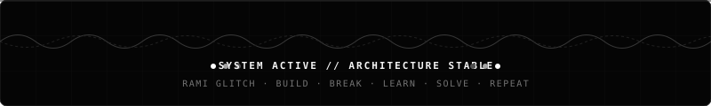

<div align="center">

# RAMI GLITCH

**Full-Stack Developer · AI-Native Engineer · Security Enthusiast**

`Solo dev Vibe Coding | Directing autonomous agents | Architecting resilient systems`

<br />

[](https://github.com/ramiglitch)
[](https://www.linkedin.com/in/tebizi-akram-rami-747829355/)
[](https://www.instagram.com/rganzheitlich/)

<br />

<!-- SECTION B: ANIMATED TERMINAL IDENTITY -->


<details>
<summary><b>Terminal Identity (Accessible Text Fallback)</b></summary>

```bash
ramiglitch@host:~$ whoami
Rami GLITCH — Full-Stack Developer · AI-Native Engineer · Security Enthusiast

ramiglitch@host:~$ cat manifest.json | jq .focus_areas
[
  "Vibe Coding & Agentic Workflows",
  "Autonomous Agent Harnesses & Tooling",
  "Cybersecurity & Network Reconnaissance",
  "Resilient Architecture & Scalable APIs"
]

ramiglitch@host:~$ echo $CORE_PHILOSOPHY
"I direct the AI. I own the architecture."
```
</details>

</div>

---

## 01 · ABOUT ME

I build complete products across the stack, direct autonomous AI coding agents to accelerate delivery, and maintain strict engineering ownership over system architecture, security boundaries, and code quality.

```text
Understand Constraints ──► Direct AI Agents ──► Audit Code & Diff ──► Ship & Harden
```

- **Vibe Coding as Engineering Discipline**: AI-assisted development is not an abdication of architectural rigor—it is an amplifier of engineering intent. I orchestrate AI agents like a disciplined engineering team while inspecting diffs, validating edge cases, verifying memory constraints, and ensuring security boundaries.
- **Agent Tooling & Harnesses**: Passionate about creating runtime harnesses, tool integrations via the Model Context Protocol (MCP), and local LLM pipelines that turn models into capable software co-workers.
- **Cybersecurity & System Internals**: Driven by understanding how systems behave from the inside out—exploring network telemetry, reconnaissance, OSINT, and defensive posture.

---

## 02 · ENGINEERING MATRIX

| Domain | Focus & Applied Capabilities | Verified Technologies |
| :--- | :--- | :--- |
| **AI Systems & Agents** | Multi-Agent Coordination, Harness Design, MCP Protocols, Local LLMs | `MCP` `Ollama` `Claude Code` `Cursor` `OpenAI APIs` |
| **Vibe Coding Workflow** | Architecture Direction, Strict Diff Audits, Iterative Prompts, TDD | `Git` `GitHub` `Linux CLI` `System Internals` |
| **Full-Stack Engineering** | Reactive State, Live Geometry, Composable Component Trees, REST APIs | `React 19` `TypeScript` `Next.js` `Vite` `Node.js` `FastAPI` |
| **Languages & Runtimes** | Strict Static Typing, Asynchronous Systems, Scripting & Native Logic | `TypeScript` `JavaScript` `Python` `C++` `C#` |
| **Data & Infrastructure** | Relational Schemas, Realtime Synchronization, Containerization | `PostgreSQL` `Supabase` `Prisma` `Docker` `Ubuntu` |
| **Security & Reconnaissance** | Network Analysis, Packet Inspection, Threat Modeling, OSINT | `Wireshark` `Nmap` `Linux Tools` `Defensive Auditing` |

---

## 03 · TECH STACK

<div align="left">

#### Languages & Core Runtimes
[](https://www.typescriptlang.org/)
[](https://developer.mozilla.org/en-US/docs/Web/JavaScript)
[](https://www.python.org/)
[](https://isocpp.org/)
[](https://learn.microsoft.com/en-us/dotnet/csharp/)
[](https://nodejs.org/en)

#### Frameworks & Frontend Engineering
[](https://react.dev/)
[](https://nextjs.org/)
[](https://vite.dev/)
[](https://tailwindcss.com/)
[](https://gsap.com/)

#### AI, Agents & Developer Tooling
[](https://modelcontextprotocol.io/)
[](https://ollama.com/)
[](https://claude.ai/)
[](https://cursor.com/)

#### Infrastructure, Data & Security
[](https://www.postgresql.org/)
[](https://supabase.com/)
[](https://www.docker.com/)
[](https://ubuntu.com/)
[](https://www.wireshark.org/)
[](https://nmap.org/)

</div>

---

## 04 · FEATURED PROJECTS

### ⚡ TieWork — Composable AI Agent Harness & Runtime Platform

> **Extensible desktop and web agent platform with composable plugin architecture and deep tool integration.**

- **Architecture**: Engineered around an "everything-is-a-plugin" paradigm powered by Cordis, integrating multi-agent session runners, terminal emulation, tool sandboxes, and browser/computer-use automation.
- **Implemented Work**: Monorepo orchestration supporting desktop client builds (Electron), web clients (React/Vite), Model Context Protocol (MCP) tool integration, and custom branded runtime configurations.
- **Tech Stack**: `TypeScript` · `Electron` · `React` · `Vite` · `Cordis` · `MCP` · `Node.js`
- **Current Status**: *Active Development / Preview (v0.2.1-rc.2)*

---

### 🐱 Glitch Rami Portfolio — Scroll-Driven Cat & Yarn Architecture

> **A precision scroll-driven portfolio engine featuring real-time geometry calculation and timeline scrubbing.**

- **Architecture**: Measures DOM element anchors dynamically at runtime, constructs a single Catmull-Rom to cubic Bézier spline across alternating layout stops, and samples the curve into an arc-length Lookup Table (LUT).
- **Implemented Work**: Master GSAP ScrollTrigger timeline coordinating persistent motion vectors, Lenis smooth scrolling, typography tokens, and responsive mobile adaptation.
- **Tech Stack**: `React 19` · `TypeScript` · `GSAP` · `ScrollTrigger` · `Lenis` · `Vite`
- **Current Status**: *Complete / Deployment-Ready*

---

### 🌐 rganzheitlich — Public Technical Portfolio & Identity

> **Centralized public technical presence detailing development interests, verified profiles, and core focus areas.**

- **Overview**: Initial repository establishing developer identity, public communication channels, and technical exploration areas across AI, cybersecurity, and full-stack software.
- **Repository**: [ramiglitch/rganzheitlich](https://github.com/ramiglitch/rganzheitlich)
- **Status**: *Published*

---

## 05 · GITHUB ANALYTICS

<div align="center">

[](https://github.com/ramiglitch)
&nbsp;
[](https://github.com/ramiglitch)

[](https://github.com/ramiglitch)

</div>

---

## 06 · SIGNATURE

```text
  ____      _    __  __ ___    ____ _     ___ _____ ____ _   _ 
 |  _ \    / \  |  \/  |_ _|  / ___| |   |_ _|_   _/ ___| | | |
 | |_) |  / _ \ | |\/| || |  | |  _| |    | |  | || |   | |_| |
 |  _ <  / ___ \| |  | || |  | |_| | |___ | |  | || |___|  _  |
 |_| \_\/_/   \_\_|  |_|___|  \____|_____|___| |_| \____|_| |_|
```

---

<!-- SECTION I: ANIMATED SVG FOOTER -->
<div align="center">
  
</div>
