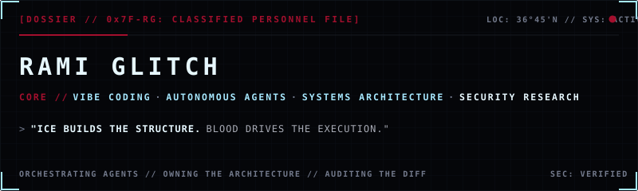
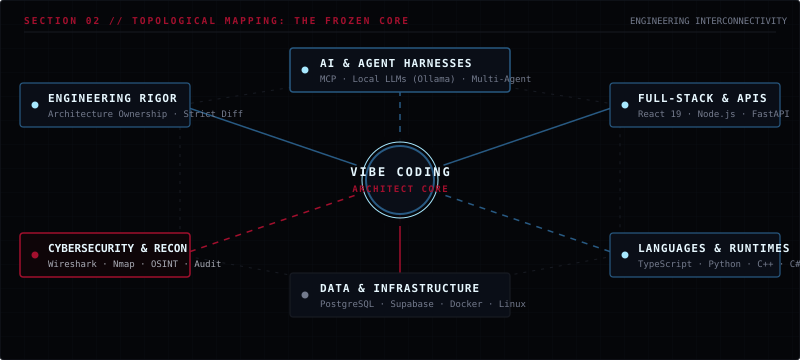
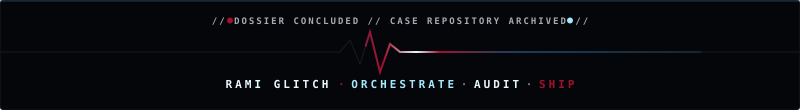

<div align="center">

<!-- FROZEN BLOOD // HERO DOSSIER -->


<br /><br />

[](https://github.com/ramiglitch)
&nbsp;
[](https://www.linkedin.com/in/tebizi-akram-rami-747829355/)
&nbsp;
[](https://www.instagram.com/rganzheitlich/)

</div>

---

### `01 / PERSONNEL DOSSIER — OPERATIONAL ETHOS`

> **`A DEVELOPER DOSSIER // WHERE ICE MEETS BLOOD`**  
> *Ice represents architectural precision, structural discipline, and strict verification.*  
> *Blood represents the intensity of execution, rapid prompt-to-product iterations, and decisive shipping.*

I build complete products across the stack, direct autonomous AI coding agents to accelerate delivery, and maintain uncompromising personal ownership over architecture, security posture, and code quality.

```text
┌─────────────────┐       ┌─────────────────┐       ┌─────────────────┐       ┌─────────────────┐
│  01 // INTENT   │ ────► │  02 // AGENTS   │ ────► │  03 // AUDIT    │ ────► │  04 // SHIP     │
│ Map Constraints │       │ Dispatch LLMs   │       │ Read the Diff   │       │ Harden & Deploy │
└─────────────────┘       └─────────────────┘       └─────────────────┘       └─────────────────┘
```

* **Vibe Coding with Engineering Rigor**: Directing AI coding models is not an abdication of engineering discipline—it is an amplifier of engineering intent. I orchestrate autonomous agents like a small engineering unit while inspecting diffs, validating edge cases, verifying memory constraints, and maintaining security boundaries.
* **Autonomous Harnesses & Tooling**: Deeply invested in building extensible runtime harnesses, Model Context Protocol (MCP) integrations, and local LLM execution environments that turn foundation models into dependable software co-workers.
* **Forensic Security & Systems Research**: Driven by understanding how systems behave from the inside out—exploring network telemetry, reconnaissance, OSINT, and defensive posture.

---

### `02 / THE FROZEN CORE — ARCHITECTURAL TOPOLOGY`

<div align="center">
  
</div>

<br />

| Vector | Classification & Focus Areas | Verified Technologies & Runtimes |
| :--- | :--- | :--- |
| **`AI & AGENTS`** | Multi-Agent Coordination, Harness Design, MCP Protocols, Local LLMs | `MCP` · `Ollama` · `Claude Code` · `Cursor` · `OpenAI APIs` |
| **`VIBE CODING`** | Intent Specification, Strict Diff Reviews, Iterative Scaffolding, TDD | `Git` · `GitHub` · `Linux CLI` · `System Internals` |
| **`FULL-STACK`** | Component Architecture, Dynamic Geometry, High-Throughput APIs | `React 19` · `TypeScript` · `Next.js` · `Vite` · `FastAPI` · `Node.js` |
| **`LANGUAGES`** | Strict Static Typing, Native Logic, Asynchronous Pipelines | `TypeScript` · `JavaScript` · `Python` · `C++` · `C#` |
| **`DATA & CLOUD`** | Relational Schemas, Real-Time Sync, Containerized Deployments | `PostgreSQL` · `Supabase` · `Prisma` · `Docker` · `Linux / Ubuntu` |
| **`CYBERSECURITY`** | Network Telemetry, Packet Analysis, Vulnerability Auditing, OSINT | `Wireshark` · `Nmap` · `Linux Security Tools` · `Defensive Analysis` |

---

### `03 / FORENSIC EVIDENCE FILES — PROJECT INTELLIGENCE`

```text
[EVIDENCE BOARD // ACTIVE INVESTIGATION FILES]
```

#### 📁 `CASE FILE: 0x01` // TieWork — Composable AI Agent Harness & Runtime Platform
* **Classification**: `[ACTIVE SPECIMEN // MULTI-PLATFORM AGENT HARNESS]`
* **System Profile**: An extensible desktop and web agent platform built around an "everything-is-a-plugin" paradigm powered by Cordis. Integrates multi-agent session runners, terminal emulation, tool sandboxes, and browser/computer-use automation.
* **Forensic Evidence**: Modular monorepo hosting Electron desktop client builds, React/Vite web clients, Model Context Protocol (MCP) tool integration, and custom branded runtime configurations authored by `TieWork <aurag@tiework.local>`.
* **Technical Stack**: `TypeScript` · `Electron` · `React` · `Vite` · `Cordis` · `MCP` · `Node.js`
* **Development Status**: `ACTIVE PREVIEW // v0.2.1-rc.2`

---

#### 📁 `CASE FILE: 0x02` // Glitch Rami Portfolio — Scroll-Driven Cat & Yarn Architecture
* **Classification**: `[DEPLOYMENT SPECIMEN // REAL-TIME GEOMETRY ENGINE]`
* **System Profile**: A precision scroll-driven personal portfolio engine featuring real-time DOM geometry measurement, spline interpolation, and timeline scrubbing.
* **Forensic Evidence**: Measures element anchors dynamically at runtime, constructs a continuous Catmull-Rom to cubic Bézier spline across alternating layout stops, and samples the curve into an arc-length Lookup Table (LUT) driven by a master GSAP ScrollTrigger timeline.
* **Technical Stack**: `React 19` · `TypeScript` · `GSAP` · `ScrollTrigger` · `Lenis` · `Vite`
* **Development Status**: `VERIFIED // DEPLOYMENT-READY`

---

#### 📁 `CASE FILE: 0x03` // rganzheitlich — Public Technical Portfolio & Identity
* **Classification**: `[PUBLIC ARCHIVE // REPOSITORY]`
* **System Profile**: Initial developer portfolio and public technical presence repository detailing verified project interests, contact vectors, and core technical disciplines.
* **Repository Access**: [github.com/ramiglitch/rganzheitlich](https://github.com/ramiglitch/rganzheitlich)
* **Development Status**: `PUBLISHED`

---

> **`FORENSIC DISCLOSURE // CASE: RIMA`**  
> *Audit Note: Following comprehensive local filesystem and remote GitHub exploration, candidate project RIMA was omitted from active case cards due to absence of an active codebase in the audited environment.*

---

### `04 / FORENSIC TELEMETRY CONSOLE — EXECUTION AUDIT`

<div align="center">
  

  <details>
  <summary><b>Console Inspection Output (Accessible Text Fallback)</b></summary>

  ```bash
  sec-node:~$ identity.inspect()
  [SUBJECT] Rami GLITCH · Full-Stack Developer · AI-Native Engineer · Security Enthusiast

  sec-node:~$ harness.status()
  [EVIDENCE] TieWork preview active // Monorepo Cordis Plugin Platform // Electron & Web

  sec-node:~$ echo $CORE_PROTOCOL
  [LAW] "I direct the AI. I own the architecture."
  ```
  </details>
</div>

---

### `05 / SYSTEM TELEMETRY & SURVEILLANCE`

<div align="center">

[](https://github.com/ramiglitch)
&nbsp;
[](https://github.com/ramiglitch)

[](https://github.com/ramiglitch)

</div>

---

### `06 / BLOODLINE SIGNATURE`

```text
  ____      _    __  __ ___    ____ _     ___ _____ ____ _   _ 
 |  _ \    / \  |  \/  |_ _|  / ___| |   |_ _|_   _/ ___| | | |
 | |_) |  / _ \ | |\/| || |  | |  _| |    | |  | || |   | |_| |
 |  _ <  / ___ \| |  | || |  | |_| | |___ | |  | || |___|  _  |
 |_| \_\/_/   \_\_|  |_|___|  \____|_____|___| |_| \____|_| |_|
```

<div align="center">
  
</div>
